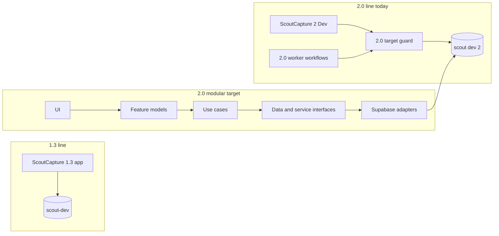

# ScoutCapture 2.0 separation map

## Baseline

- Stable checkout: `main`, Xcode version 1.3.0 build 97, backed by `scout-dev` (`chlvazmtucoszicehtnm`). Its local edits were left intact.
- Refactor checkout: `codex/2.0.0-decoupling` at `~/Documents/Codex/ScoutCapture-2.0.0`, created from fetched `origin/main` commit `b8304ee`. Xcode version 2.0.0 build 1.
- Refactor backend: `scout dev 2` (`crcylkfymmbtlmnomjwd`) in `us-east-1`, Micro compute.
- The most recent local Xcode archive was 1.3.0 build 97 on 2026-11-25 and matched the source settings. GitHub had no release entries. An App Store Connect upload record was not independently available here.

## Current separation and target

The app still has direct Supabase calls in `AppState`. The interface and adapter extraction is the next development phase; this map does not imply it is already done.

## Backend parity achieved

- Imported 18 Scout Website migrations from `scout-site@ef46714` that were absent from ScoutCapture, with provenance in each file. Identical migrations shared by both repositories were not imported twice. The report-email migration uses the ScoutCapture variant, followed by a parity reconciliation.
- Added the three report artifact tables and `scoutcapture-deliverables` bucket from a schema-only catalog of the current backend. No customer rows, Auth users, or Storage objects were copied.
- Applied all 73 migrations now in this branch. Both projects have 33 public tables, 493 columns, 220 constraints, 132 indexes, 100 public functions, and five Storage buckets.
- Added the seven missing Storage object policies. Report-email policies use the authenticated role while preserving member read and owner management behavior; the current project's equivalent policies use the public role with table grants restricted to authenticated users.
- Deployed four Edge Functions to `scout dev 2`: `background-upload-handoff`, `fast-lane-report-handoff`, `report-package-dispatch`, and `report-progress`. The `report-progress` source was recovered from the current project and committed to this branch.
- Disabled public signup in the new project's Auth configuration, matching the current project.

## Isolation controls

- 2.0 has its own Supabase URL and publishable key, bundle identifier `com.scoutsystems.scoutcapture.v2dev`, and iCloud container name. The Xcode scheme, built app, and webhook template point to the new project.
- Runtime network paths for startup, password recovery, and direct Storage upload reject any nonlocal backend other than `scout dev 2`. The regression test covers the current, legacy staging, arbitrary remote, local, and new project URLs.
- Supabase CLI link metadata is ignored in 2.0 source control. This worktree is linked to `scout dev 2`; all migration and deployment commands used an explicit project ref.
- The report, export, retention, and backfill workflows require separate `SCOUT_DEV2_*` credentials and verify the exact new URL before making backend calls. Report email notifications are disabled in the 2.0 report workflow.

## Environment setup still needed for end-to-end parity

- Configure a separate 2.0 report worker token, dispatch secret, and GitHub workflow secrets. The database report dispatch webhook remains **inactive**, so the new project cannot dispatch into the current worker.
- Configure a 2.0 web portal/callback URL and test email transport. Live SMTP credentials, templates, and production redirects were deliberately not copied. Auth signup is closed; create dedicated test users through an authorized admin flow when the portal is ready.
- Register/provision the separate iCloud container and app identifier before installing a signed device build. Simulator build and focused target-guard test succeeded.
- Validate representative Auth, Storage, report, and UI flows with test data. Schema equivalence alone does not prove runtime feature parity.

## Next refactor slice

Define a database port for one feature, implement it with Supabase in an adapter, and move that feature's calls out of `AppState`. Keep behavior tests against the current contract and the new project before expanding to the remaining features.
