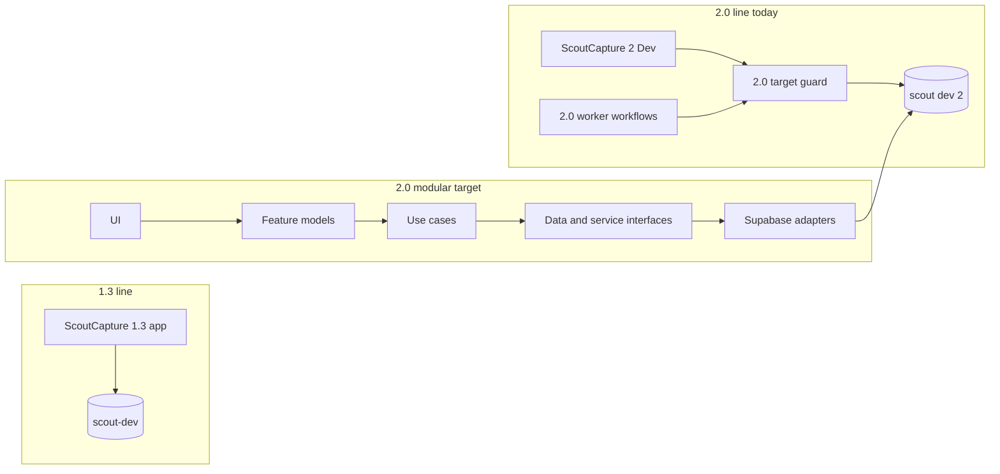
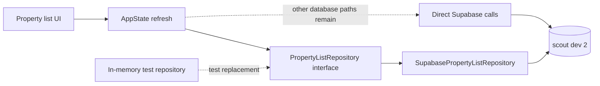

# ScoutCapture 2.0 separation map

## Baseline

- Stable checkout: `main`, Xcode version 1.3.0 build 97, backed by `scout-dev` (`chlvazmtucoszicehtnm`). Its local edits were left intact.
- Refactor checkout: `codex/2.0.0-decoupling` at `~/Documents/Codex/ScoutCapture-2.0.0`, created from fetched `origin/main` commit `b8304ee`. Xcode version 2.0.0 build 1.
- Refactor backend: `scout dev 2` (`crcylkfymmbtlmnomjwd`) in `us-east-1`, Micro compute.
- The most recent local Xcode archive was 1.3.0 build 97 on 2026-11-25 and matched the source settings. GitHub had no release entries. An App Store Connect upload record was not independently available here.

## Current separation and target

The property-list read is the first completed interface slice. Other direct Supabase calls in `AppState` remain to be extracted one feature at a time.

The foreground refresh, background refresh, and diagnostic read all share this property-list path. The interface returns database-independent property-list records; Supabase column decoding stays inside the adapter. `AppState` still applies the existing three-second timeout, organization and field validation, local cache merge, and refresh authority checks.

## Draft recovery priority (planned)

The capture checkmark means the shot was saved on this device. A separate cloud at the left of the same thumbnail must mean its original file and shot record were confirmed in Supabase; queued, uploading, and failed states need distinct indicators. The existing standard capture path starts individual media uploads after local save. Fast-lane draft photos currently stay local until its completion flow, so they need the same per-shot upload path before a confirmed cloud can appear during a draft.

Protect the original photo, its checksum and shot metadata, and enough session state to resume: property/session identity, labels and placement, notes, flags, issue updates, guided progress, and pending upload state. Derived list counts, thumbnails, and other rebuildable UI caches can remain local. A later `DraftCheckpointRepository` slice will make this non-photo state restorable from Supabase. Do not mark a draft cloud-protected until a second-device restore proves the checkpoint and its media can be reconstructed.

## Backend parity achieved

- Imported 18 Scout Website migrations from `scout-site@ef46714` that were absent from ScoutCapture, with provenance in each file. Identical migrations shared by both repositories were not imported twice. The report-email migration uses the ScoutCapture variant, followed by a parity reconciliation.
- Added the three report artifact tables and `scoutcapture-deliverables` bucket from a schema-only catalog of the current backend. No customer rows, Auth users, or Storage objects were copied.
- Applied all 73 migrations now in this branch. Both projects have 33 public tables, 493 columns, 220 constraints, 132 indexes, 100 public functions, and five Storage buckets.
- Added the seven missing Storage object policies. Report-email policies use the authenticated role while preserving member read and owner management behavior; the current project's equivalent policies use the public role with table grants restricted to authenticated users.
- Deployed four Edge Functions to `scout dev 2`: `background-upload-handoff`, `fast-lane-report-handoff`, `report-package-dispatch`, and `report-progress`. The `report-progress` source was recovered from the current project and committed to this branch.
- Disabled public signup in the new project's Auth configuration, matching the current project.

## Isolation controls

- 2.0 has its own Supabase URL and publishable key, bundle identifier `com.scoutsystems.scoutcapture.v2dev`, and currently an isolated iCloud entitlement slated for removal. The Xcode scheme, built app, and webhook template point to the new project.
- The 2.0 test app uses a red home screen icon in normal and dark appearance and displays as `Scout Capture 2 Dev` so it is easy to distinguish on a device.
- Runtime network paths for startup, password recovery, and direct Storage upload reject any nonlocal backend other than `scout dev 2`. The regression test covers the current, legacy staging, arbitrary remote, local, and new project URLs.
- Supabase CLI link metadata is ignored in 2.0 source control. This worktree is linked to `scout dev 2`; all migration and deployment commands used an explicit project ref.
- The report, export, retention, and backfill workflows require separate `SCOUT_DEV2_*` credentials and verify the exact new URL before making backend calls. Report email notifications are disabled in the 2.0 report workflow.

## Environment setup still needed for end-to-end parity

- Configure a separate 2.0 report worker token, dispatch secret, and GitHub workflow secrets. The database report dispatch webhook remains **inactive**, so the new project cannot dispatch into the current worker.
- Configure a 2.0 web portal/callback URL and test email transport. Live SMTP credentials, templates, and production redirects were deliberately not copied. Auth signup is closed; create dedicated test users through an authorized admin flow when the portal is ready.
- Remove the 2.0 iCloud entitlement before a signed device test build, then provision the app identifier without iCloud. iCloud is not required for the 2.0 runtime, but draft/photo recovery must be verified before treating the no-iCloud model as production-ready. Simulator build and focused target-guard test succeeded.
- Validate representative Auth, Storage, report, and UI flows with test data. Schema equivalence alone does not prove runtime feature parity.

## Refactor checklist

1. **Done — property-list read.** `PropertyListRepository` defines the read contract; `SupabasePropertyListRepository` owns the Supabase query; an in-memory implementation exercises replacement in a focused test. All three callers use the same interface through `AppState`.
2. **Next — per-shot media protection.** Define `ShotMediaRepository`, move the existing standard-capture Supabase upload behind its adapter, add fast-lane draft uploads, preserve a durable local retry queue, and drive a per-shot cloud indicator in the Guided and Active lists from verified upload state. This item has not been implemented yet.
3. **After that — restorable draft checkpoint.** Define `DraftCheckpointRepository` for session metadata and user-created context, with Supabase and in-memory implementations. Verify recovery on a second device before relying on it instead of iCloud.
4. **Then — property writes.** Inventory create, edit, archive, and delete flows, then move their Supabase calls into a property adapter while preserving local-first and conflict rules.
5. **Later — remaining features.** Extract sessions beyond draft recovery, authentication, organization access, reports, and other service paths individually, updating this map and parity checks with each slice.

Four focused simulator tests passed: in-memory replacement, Supabase row conversion, deleted-at mapping, and capture-profile mapping. These prove the property-list seam can be swapped and existing mappings still work. Live behavior against `scout dev 2` still needs dedicated test users and data.
