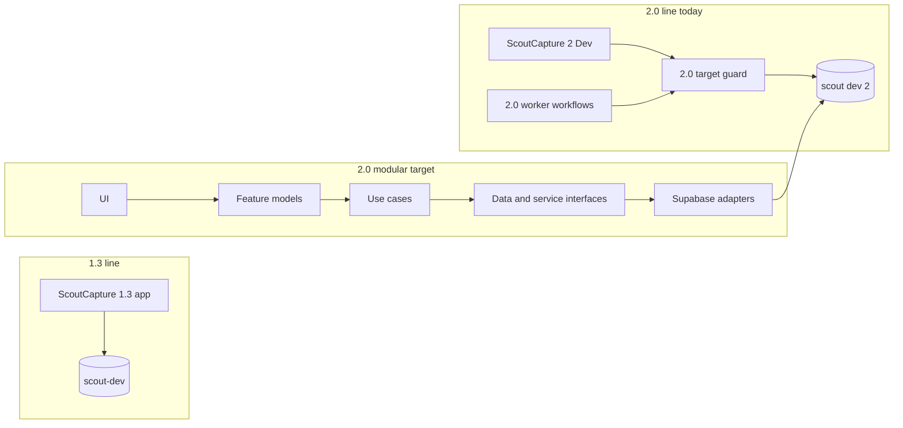
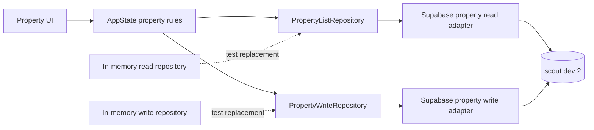

# ScoutCapture 2.0 separation map

## Baseline

- Stable checkout: `main`, Xcode version 1.3.0 build 97, backed by `scout-dev` (`chlvazmtucoszicehtnm`). Its local edits were left intact.
- Refactor checkout: `codex/2.0.0-decoupling` at `~/Documents/Codex/ScoutCapture-2.0.0`, created from fetched `origin/main` commit `b8304ee`. Xcode version 2.0.0 build 1.
- Refactor backend: `scout dev 2` (`crcylkfymmbtlmnomjwd`) in `us-east-1`, Micro compute.
- The most recent local Xcode archive was 1.3.0 build 97 on 2026-11-25 and matched the source settings. GitHub had no release entries. An App Store Connect upload record was not independently available here.

## Current separation and target

Property-list reads and property writes now have separate replaceable interfaces. The UI still goes through `AppState`; the Supabase SDK and property write queries are confined to the write adapter for this slice. Other feature paths in `AppState` remain direct until their own turn.

The write interface covers insert, upsert, capture-profile update, soft delete, and restore. Existing local-first edits, offline queueing, archive behavior, remote-create ordering, conflict handling, and pre-delete checks stay in `AppState`. All remaining direct `properties` table calls there are reads; those will move with their feature slices. The offline mutation queue still serializes the legacy Supabase-shaped payload for compatibility with queued 1.3/early 2.0 work. That payload and the large `AppState` orchestration remain coupling to remove when the queue and feature use cases are extracted.

## Future no-iCloud recovery requirement (planned)

The capture checkmark means the shot was saved on this device. A separate cloud at the left of the same thumbnail must mean its original file and shot record were confirmed in Supabase; queued, uploading, and failed states need distinct indicators. The existing standard capture path starts individual media uploads after local save. Fast-lane draft photos currently stay local until its completion flow, so they need the same per-shot upload path before a confirmed cloud can appear during a draft.

Protect the original photo, its checksum and shot metadata, and enough session state to resume: property/session identity, labels and placement, notes, flags, issue updates, guided progress, and pending upload state. Derived list counts, thumbnails, and other rebuildable UI caches can remain local. When this requirement reaches its turn in the refactor, a `DraftCheckpointRepository` slice can make this non-photo state restorable from Supabase. Do not mark a draft cloud-protected until a second-device restore proves the checkpoint and its media can be reconstructed.

## Backend parity achieved

- Imported 18 Scout Website migrations from `scout-site@ef46714` that were absent from ScoutCapture, with provenance in each file. Identical migrations shared by both repositories were not imported twice. The report-email migration uses the ScoutCapture variant, followed by a parity reconciliation.
- Added the three report artifact tables and `scoutcapture-deliverables` bucket from a schema-only catalog of the current backend. No customer rows, Auth users, or Storage objects were copied.
- The initial parity check had 73 applied migrations; both projects then had 33 public tables, 493 columns, 220 constraints, 132 indexes, 100 public functions, and five Storage buckets. Subsequent 2.0-only fixes are recorded below and intentionally diverge from the 1.3 backend.
- Added the seven missing Storage object policies. Report-email policies use the authenticated role while preserving member read and owner management behavior; the current project's equivalent policies use the public role with table grants restricted to authenticated users.
- Deployed four Edge Functions to `scout dev 2`: `background-upload-handoff`, `fast-lane-report-handoff`, `report-package-dispatch`, and `report-progress`. The `report-progress` source was recovered from the current project and committed to this branch.
- Disabled public signup in the new project's Auth configuration, matching the current project.

## Isolation controls

- 2.0 has its own Supabase URL and publishable key and bundle identifier `com.scoutsystems.scoutcapture.v2dev`. Its dev target now has no iCloud entitlement. The Xcode scheme, built app, and webhook template point to the new project.
- The 2.0 test app uses a red home screen icon in normal and dark appearance and displays as `Scout Capture 2 Dev` so it is easy to distinguish on a device.
- Runtime network paths for startup, password recovery, and direct Storage upload reject any nonlocal backend other than `scout dev 2`. The regression test covers the current, legacy staging, arbitrary remote, local, and new project URLs.
- Supabase CLI link metadata is ignored in 2.0 source control. This worktree is linked to `scout dev 2`; all migration and deployment commands used an explicit project ref.
- The report, export, retention, and backfill workflows require separate `SCOUT_DEV2_*` credentials and verify the exact new URL before making backend calls. Report email notifications are disabled in the 2.0 report workflow.

## Environment setup still needed for end-to-end parity

- Configure a separate 2.0 report worker token, dispatch secret, and GitHub workflow secrets. The database report dispatch webhook remains **inactive**, so the new project cannot dispatch into the current worker.
- A dedicated confirmed test owner account and `Scout Dev 2 Test` organization now exist in `scout dev 2`; public signup remains closed. Configure a 2.0 web portal/callback URL and test email transport before relying on invitations or password recovery. Live SMTP credentials, templates, and production redirects were deliberately not copied.
- The 2.0 iCloud entitlement was removed to use the available non-iCloud provisioning profile. A signed 2.0.0 build 1 app was installed on BB iPhone with the separate `com.scoutsystems.scoutcapture.v2dev` identifier. The current 1.3 app was untouched. The 2.0 dev app has no iCloud backup entitlement; use test data until Supabase draft/photo recovery is verified. This device setup did not change the decoupling order.
- Validate representative Auth, Storage, report, and UI flows with test data. Schema equivalence alone does not prove runtime feature parity.

## Live property-write check on BB iPhone

- In `Scout Dev 2 Test`, the owner test account created `2.0 Property Test`, edited its name, and saved test client, address, phone, and email fields. A read-only query confirmed those values in `scout dev 2`.
- Archive and unarchive changed the remote `is_archived` value from false to true and back. The user then deleted and restored the property in the app; the final remote row is active with `deleted_at = null`. No database snapshot was taken between deletion and restoration.
- A live delete confirmed `deleted_at` in Supabase, but no `property.deleted` activity event persisted. The app emits that event after the soft-delete RPC, and the previous event scope rejected deleted properties. Migration `202611280001` now allows only authorized owner/manager delete events for a soft-deleted property; the original insert rule still governs other event types. A transactional SQL regression passed and rolled back its fixture. A post-fix delete from the installed app persisted both `deleted_at` and the attributed `property.deleted` event in `scout dev 2`. The user restored the property; the remote row is active again and a `property.restored` event followed. This property-write parity fix did not change the next decoupling item.

## Refactor checklist

1. **Done — property-list read.** `PropertyListRepository` defines the read contract; `SupabasePropertyListRepository` owns the Supabase query; an in-memory implementation exercises replacement in a focused test. All three callers use the same interface through `AppState`.
2. **Done — property writes.** `PropertyWriteRepository` defines the write contract and `SupabasePropertyWriteRepository` owns the table mutations and soft-delete/restore RPCs. Create, edit, archive, profile updates, remote soft delete, and restore route through it. Local-only delete remains local, and queued offline writes retain their existing serialized format. An injected writer test covers create, edit, and archive without a Supabase client.
3. **Recorded future requirement — no-iCloud draft recovery.** When scheduled in the original feature-by-feature refactor, define `ShotMediaRepository` and `DraftCheckpointRepository`, protect standard and fast-lane captures and important session context in Supabase, and show verified per-shot cloud status in the Guided and Active lists. This discussion does not change the next item.
4. **Later — remaining features.** Extract sessions, shots and media, authentication, organization access, reports, and other service paths individually, updating this map and parity checks with each slice. Session data is the next feature slice to inventory; the recorded no-iCloud recovery requirement stays in its original future position.

The property-write focused simulator runs passed 32 tests: 16 for injected-writer create/edit/archive and cutover behavior, plus 16 for property soft delete, restore, and hub refresh. The restore test now supplies an empty recently-deleted prefetch instead of querying a placeholder backend; production logic was unchanged. The earlier property-list interface run passed four focused tests. A dedicated test owner and organization now exist in `scout dev 2`. Representative Auth, property, media, and report behavior still needs device testing with test data.
